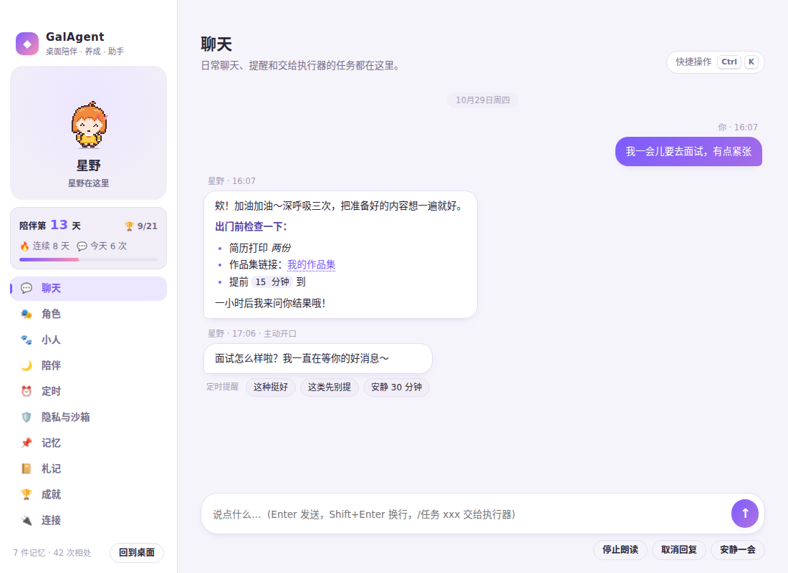

# GalAgent

一个放在 Windows 桌面上的像素小人陪伴 Agent：选一位角色或自己写一张角色卡，挑一个像素小人，TA 会陪你聊天、记住你的事、按你定的节奏主动来找你，也能在沙箱里替你在本机干活。



## 核心特性

1. **角色卡（人设）完全可编辑**
   - 内置 7 张风格各异的角色卡：元气同桌「星野」、温和学长「白砚」、猫室友「团子」、私人秘书「阿律」、损友「小橘」、治愈系「暖暖」、恐龙博士「诺瓦」。
   - 「角色」页可新建 / 复制修改 / 删除 / 导入导出角色卡（`galagent-persona@1` JSON），字段包括性格、说话方式、背景、关系、称呼、喜好、边界、初见问候、发呆小词条、声音风格。
   - 一句话描述即可「✨ AI 起草」整张卡，确认后再保存。
   - 通用守则（坦诚是 AI、不编造记忆、尊重安静请求、外部内容只当数据）对所有角色卡生效，角色卡改不动它们。
2. **14 个内置像素小人 + 自定义小人**
   - 小晴、书生、小桃、小魔女、麻薯猫、橘子狐、团子兔、小恐博士、机器人小铆、棉花云、果冻史莱姆、幽幽、豆豆企鹅、蘑蘑，全部原创像素画（`runtime/shared/pixel-pets/`）。
   - 弹簧驱动的呼吸、眨眼、走路 / 蹦跳 / 漂浮、挤压回弹、拖拽晃荡、粒子特效（爱心、星星、zZ、思考点点）。
   - 自定义：按 [`skills/galagent-pixel-pet`](skills/galagent-pixel-pet/SKILL.md) 写一份 JSON（可交给任何 AI），用 `npm run pet:validate` / `npm run pet:preview` 校验预览，放进 `%APPDATA%/GalAgent/pets/` 自动识别，或在「小人」页导入。
3. **定时自唤醒（伪主动）**
   - 主角色理解你的话后自己调用 `schedule_wakeup` 工具设闹钟（相对分钟 / 时刻 / cron / 重复），到点系统叫醒的是主角色本人，由 TA 决定怎么开口；执行器的 Cron 工具也会唤醒主角色。网关不支持工具时自动改用回复 JSON 里的 `schedule` 字段。
   - 「定时」页可手动新建 / 取消提醒；你设的提醒在专注模式也会响，免打扰时段会顺延。
4. **主动陪伴全部由你设定**
   - 选项类（陪伴模式、话题开关、免打扰时段、漫步、自动朗读…）点选；数值类（最短间隔、每小时 / 每天上限、注意力心跳、久未回应、重逢、打盹、气泡停留、漫步速度、截屏间隔…）可填任意数字，程序只把不合理的值收拢到安全范围。
5. **隐私与沙箱**
   - 执行器三档沙箱：严格（只读工作目录、无 Shell、无联网）/ 标准（默认，工作目录内读写、无 Shell、仅公网）/ 宽松；各开关可单独调整，并可设域名白名单与禁止访问的文件夹。
   - 出站防外泄：发往模型、语音服务和联网工具的内容会先隐藏 API Key、私钥、令牌、密码，可选隐藏身份证 / 银行卡 / 手机号 / 邮箱和自定义敏感词；网址里带敏感内容的请求直接拦截。只记录类别与次数，从不保存被隐藏的内容。
   - 凭据文件（`.ssh`、`.aws`、`.env`、`*.pem`、`*.kdbx`、浏览器登录数据、GalAgent 自己的密钥）永远不可被工具读取；「一键隐私锁定」立即停止观察、中止任务并切到严格沙箱。
   - 这是应用内保护，不等同于操作系统沙箱。
6. **更流畅的界面**
   - 小人头顶的状态标签（思考中 / 执行任务中 / 打盹 / 几分钟后提醒你…）、打字机气泡、节日与时段小词条、连戳 5 下会晕、摇晃会转晕、主界面输入 ↑↑↓↓←→←→BA 有彩蛋。
   - 圆润的浅色 / 深色自适应主题，页面切换与消息出现都有缓动动画，可在设置里减少动态效果。
7. **记忆 v2**：每天 0 点把前一天整理成「每日档案」（摘要、日记、话题、高光、待续）并更新用户画像；第二天上下文用档案代替原文，原文仍在本地，TA 可用 `recall_day` 翻看；被引用的记忆会按遗忘曲线强化。详见 [docs/记忆系统-v2.md](docs/记忆系统-v2.md)。
8. **彩蛋与成就**：摸头、甩飞、蓄力跳、零点见、整点报时、四季粒子等，21 个成就徽章与陪伴天数；主界面 Ctrl+K 命令面板。
9. **原有能力保留**：长期记忆（ADD / UPDATE / DELETE + 历史有效期 + 本地语义检索）、注意力代理（事件即时 + 可调心跳）、全局 20 路并发池、25 个本地工具执行器、浏览器扩展感知、TTS（小米 MiMo / OpenAI 兼容 / 系统语音）。

## 快速启动

1. 双击「`启动 GalAgent.cmd`」（指向 `release/dual-core/win-unpacked/GalAgent.exe`，需先打包，见下）。
2. 右键小人 → 打开聊天 → 「连接」页填入任意 OpenAI 兼容接口（预设：Mira 本地反代、DeepSeek、Moonshot、通义千问、OpenAI、本地 Ollama）。
3. 「角色」页挑一位角色，「小人」页挑一个形象，开始相处。

## 开发

Node 24：

```powershell
npm install
npm run typecheck
npm test                 # 单元与集成测试
npm run build
npm run preview:ui       # 无头 Chrome 截图：桌宠窗口 + 9 个页面 → docs/evidence/ui/
npx electron-builder --win dir --x64 --config.directories.output=release/dual-core --config.electronDist=node_modules/electron/dist
node tests/e2e/dual-core.mjs   # 打包后隔离数据目录端到端验收（Windows）
```

## 目录

- `runtime/core/`：陪伴服务（`companion.ts`）、角色卡（`persona.ts`）、定时自唤醒（`scheduler.ts`）、隐私守卫与沙箱（`privacy.ts`）、小人库（`pets.ts`）、注意力代理、记忆、执行器与工具宿主。
- `runtime/shared/`：契约类型、角色卡定义（`personas.ts`）、像素小人格式（`pixel-sprite.ts`）与内置小人。
- `runtime/renderer/`：桌宠窗口（`pet-view.ts`）、主界面（`notebook.ts`）、像素渲染器（`pixel-pet.ts`）、小词条与彩蛋（`fun.ts`）。
- `runtime/main/`：Electron 主进程、命令校验、TTS。
- `skills/galagent-pixel-pet/`：自制小人的 skill、模板与格式参考。
- `scripts/pixel-pet/`：小人生成、校验、预览、渲染演示脚本。

工程约定与红线见 [AGENTS.md](AGENTS.md)，当前进度见 [NEXT.md](NEXT.md)，版本记录见 [CHANGELOG.md](CHANGELOG.md)。

## 致谢 (Acknowledgments)

特别鸣谢以下伙伴与模型在项目设计、工程实现、视觉打磨与多模态架构中的重要贡献：

- **Gemini4argon**
- **opus5.5**
- **gpt-Astra**
