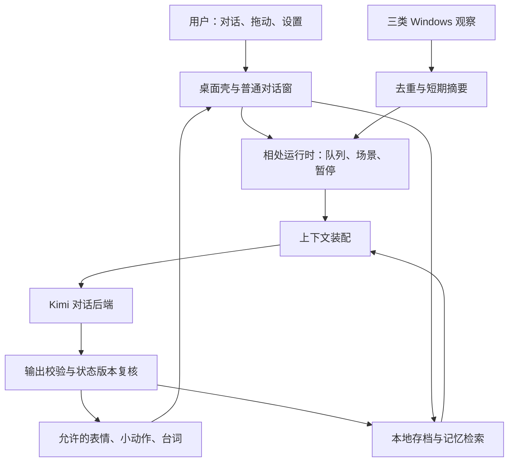

# GalAgent 总设计案 v1

修订1.6 · DUAL-CORE-20261017：用户确认两个并列核心——**主动陪伴**与**上下文管理**，详见第15节及[双核心设计](主动陪伴与上下文管理-v1.md)。该文件替代6.1/6.2零散主动规划；观察边界按用户决定修订：开放截屏（默认保护）与最近50条剪贴板，按键内容仍不开放。下文9.2“三类观察”、第12节“截图视觉理解”暂存及“不读取剪贴板”的表述以第15节为准。**2026-10-17 已实现（DC1–DC5），115 项测试与隔离打包原生验收通过；真实 K3 与真实桌面截屏待用户环境验证**，运行包 `release/dual-core`。

修订1.5 · OPENAI-KIMI-TOOLS-20261010：正式工具层使用用户已有OpenAI兼容API，按捕获文档兼容25个Kimi工具。主角色只负责人设/交流与委派；执行器和并行/后台/状态由GalAgent自己实现。原始思考及工具协议只在执行会话中保存，主角色接收有限摘要。旧CLI/ACP方案被用户纠正，不是当前架构。具体实现、验证和限制见[正式适配](OpenAI-Kimi工具正式适配.md)。Live2D与更多系统接入不自动启动。

最新范围更新：KIMI-AGENT-20261009。用户已授权并完成Kimi Code原生工具执行器适配，见[KimiCode工具适配](KimiCode工具适配-v1.md)。下文首版“不包含Agent/工具”的声明保留原首版验收边界；当前新版允许用户任务委派给本机Kimi Code，默认原生完整访问。浏览器、硬隔离、Live2D等未因此启动。主角色仍负责人设，不直接运行工具。

修订：1.4 · 2026-10-09 · 同步：VARIABLES-20261009（承接PERSONA / DOCSYNC-LD） · 状态：**人物变量已实现接入；真实Kimi人物质量待验；专属Live2D仅规划、未启动**。  
用户已确认本轮优先级：**先把人物、记忆和桌面互动做活**。随后授权完成第一版，允许子代理协助开发、不限生图额度，前端方案由 Agent 决定，以精美流畅且保持人物风格为目标。人物形体在用户后续反馈后改为透明动态桌宠：现素材二维网格骨架与局部表情层，头、眼、发梢和披肩分别运动；不依赖尚不存在的 Live2D 绑定。并行开发相互独立的模块，验收仍按阶段门收束。

项目形态：Windows 独立桌面应用。第一版的价值是持续相处；真实 agent 能力作为后续方向保留。

## 1. 她应当是什么样的存在

**她在你桌面上有一个能被看见的形体，记得你们真正发生过的事，有自己的小心思，知道什么时候靠近、什么时候安静。**

保留原作的辨识度：Kimi 模型娘化的来历、星空与棱镜母题、K 标记、嘴硬心软、简短的初遇、自己取名字、隐藏的关系变化。人物的具体记忆必须由实际相处或用户主动提供的旧经历支撑。

“以前以模型形态和你写代码”可以是来历设定，但程序不能因此虚构某次 debug、某个项目或已拥有另一个账号的聊天记录。未导入的历史只能保持模糊；以后可加入用户选择的经历导入。

第一版完成时，用户应该能感受到四件事：她与一般聊天框有不同的相处节奏；她会记住并纠正记忆；她会根据真实但有限的观察回应；她能被暂停、收回和可靠重启。

## 2. 核心体验与第一份可玩的成果

### 核心内容：缺了就不成立

| 内容 | 责任 | 可见证据 |
|---|---|---|
| 持续身份 | IdentityStore | 自取名字后重启保留，不重演初遇 |
| 人格表达 | PersonaRuntime + 美术差分 | 普通闲聊、被夸、被误会时反应有区别 |
| 可靠记忆 | MemoryStore | 换一种问法仍想起事实，纠正后不再沿用旧事实 |
| 桌面存在感 | Shell + Observation | 可摆放、会回应，有观察也知道自己的缺口 |
| 主动而有分寸 | InitiativeScheduler | 自己发起一次有来由的互动，忙碌或安静时收住 |
| 用户控制 | 本地设置与状态管理 | 暂停立即生效，重启和恢复不会丢失相处记录 |

### 第一份可玩的成果

入口：用户手动启动只显示透明人物；动态不依赖API。需要真实对话时，主动从菜单配置自己的Kimi API接入，说明哪些消息会发到模型服务。首版只面向用户自己的电脑，不做账号系统和云同步。

主路径：**相遇 → 她取名 → 用户分享一个具体偏好或经历 → 一次桌面互动 → 她自行发起小回应 → 关闭重开 → 她接着之前的相处 → 用户纠正一条记忆或让她安静。**

必交付：可双击运行的包、统一透明差分、身份与存档、聊天与有限微事件、记忆管理入口、观察开关、暂停与退出入口、验收记录、恢复说明。

当前已交付二维首版范围不包括：任意文件访问、工作区写入、shell 工具、外部 coding agent、真实键鼠操作、剪贴板或 IM 内容监听、浏览器历史、截图读图、完整长篇主线、Jev、全权限模式。专属Live2D另列为后续待启动计划，见第14节；没有因此扩展系统权限。

完成后停在用户亲手体验与一次有明确目标的调整验收；不自动开始执行能力阶段。

## 3. 三种交互空间

### 桌面上的她

透明小窗常驻在用户选择的位置，可拖动。表情和姿态默认克制，保持既定画面锚点。点击后打开对话，不在单击角色之前夺取输入焦点。

日常回应主要通过表情、短气泡与小幅动作，不通过系统通知刷屏。气泡可以不要求回复。角色相册与剧情画面留到后续；现有插画暂作风格参考。

### 展开的对话窗

使用常规不透明窗，便于中文输入、滚动、复制与长对话。用户主动打开时才获得焦点；关闭对话不等于退出人物。对话期间抑制主动插话，防止两个生成队列争抢。

显示她当前的名字和必要运行状态。网络错误、预算停止、模型不可用等信息放在简短状态栏，不要求人物替工程故障编故事。未完成的回答不能保存成成功回复。

### 相处设置与存档入口

托盘入口包含：安静一会、恢复主动互动、观察开关、记忆管理、移动回可见区域、导出存档、退出。关系数值不显示；用户仍能查看存了什么、从哪里来、是否允许继续使用。

所有演出都能一键收回。安静期间保留用户主动聊天，停止她主动发言和胡闹；锁屏 / 暂停观察后不继续采集桌面数据。

## 4. 人物表达：全时期统一

2026-10-10用户决定：取消变量驱动的分阶段人设。人物内容以[人设总册v1.3](人设总册-v1.md)为准：爱弹钢琴、可爱有活力、少傲多娇；看到用户使用其他Agent时会吃醋、气鼓鼓地胡闹；想得到关注时会讨抱抱和安慰，而且很好哄。

同一套性格从初遇贯穿日常。亲近、撒娇、活力和一点小脾气无需通过好感、熟练度、相处天数或事件数量解锁。共同经历和记忆积累影响具体话题与熟悉程度，当前心情影响这一刻的反应。

变量保留身份、记忆、关系记录、短期情绪、动作及真实时间等用途；不再决定人格阶段、阶段台词或按阶段限制表达强度。新方案中的初遇/取名仅是一次性身份流程。

接入状态：统一调色盘已接入聊天、主动、场景与日记，旧S0/S2/S3/S4和熟练度不再进入模型提示或驱动动作强度。旧字段留作存档兼容与互动统计，名字、关系和记忆保留。95项测试及隔离打包真实K3验证通过，默认入口已切换新版。变量历史实现见[人物变量系统](人物变量系统-v1.md)。

## 5. 她自己的小心思与六类微事件

第一版需要持续的小目标，否则只有“事件来了就喊一句”的机械反应。

默认小目标：**她想找到自己最适合待的位置，并慢慢形成关于你们相处的星图札记。**这里的札记是角色日记与共同经历的呈现，不是后台新任务，不读取其他软件内容。用户可以拒绝或改变相处方式。

微事件按场景规则控制资格，模型生成当次表达。六类事件覆盖一次性、重复与修复，不提前写二十条大剧情：

| ID | 触发与资格 | 可玩内容 | 状态与结束 |
|---|---|---|---|
| E01 相遇与名字 | 首启未完成 | 用户介绍自己，她自行选择名字 | 身份与首启游标同一事务提交；失败后从最近步骤续接 |
| E02 找到位置 | 第一次主动拖动；以后低频复现 | 她对你放她的位置有反应 | 保存屏幕相对位置；非用户移动不重复触发 |
| E03 记住一件事 | 用户明确分享偏好或经历 | 她回应，之后在相关语境里想起 | 保存带来源的事实；不由日记自动造事实 |
| E04 又见面 | 有旧会话、距离上次互动达到阈值 | 续接一件未完的话题或小念头 | 只使用真实记忆；没有可靠线索就普通相见 |
| E05 小小吃醋与胡闹 | 用户启用观察；可信应用标签，或用户主动提到别的 AI | 背过身、画一颗星、短暂挪远等可撤销演出 | 低频、可关闭；标题不确定时不断言用户在和谁聊天 |
| E06 收住与修复 | 用户要求安静、指出误会或纠正记忆 | 她停止并调整相处方式 | 控制立即生效；无需等待模型认可，不扣关系 |

不是每次触发都要发言。模型可以选择微动作或不表达。没有已解锁差分时，不生成“背面”动作再假装已完成。

## 6. 主动互动的节奏

### 6.1 主动触发扩展 · 2026-10-10 · 仅计划

宿主提供唤醒机会，模型决定是否表达和行动。10秒本地检查不等于每10秒调用API。候选来源：任务完成/失败、重逢等事件；可靠应用状态或话题变化；模型提出的下次关注时间/条件；明确委托的持续目标与Cron。浏览器扩展未实现，网页、标签页、收藏及历史暂不属于已有观察。

流程：信号→本地去重/冷却/过期检查→相关记忆、日记摘要及当前事件窗口→主角色选择安静/动作/说话/稍后关注/委派→执行层复核→结果摘要与证据回传。主角色负责交流、记忆选取与委派；具体工作和工具日志由现有OpenAI执行器负责，并行架构以GalAgent为准。

第一步做“任务结束后，她判断何时、怎样汇报”。候选包含唯一事件ID、任务状态、完成时间和证据引用；忙碌或安静时延后，不重复提醒，不把模型宣称当业务成功。再依次增加事件/环境触发、自行安排关注和持续目标。

访问范围与任务来源分别校验：默认广泛访问沿用用户方向；自发工作需明确委托或事先启用的具体功能依据。禁止访问目录硬隔离、浏览器扩展、键鼠控制、Live2D保持原停止点，本轮不实施。人物采用全时期统一的少傲多娇人设，按当前心情与具体经历回应。现实时间1:1，关机只结算时间，不伪造观察/执行经历，不以离线惩罚关系。

当前已有空闲触发、频率/预算和本地Cron；主动人物请求尚不能委派工具，任务摘要尚未自动转成人物口吻。上述扩展全部仅规划。

流程：观察变化 → 本地去重与冷却 → 合格念头候选 → 模型决定是否以及如何表达 → 程序复核当前环境 → 执行允许的表现 → 更新冷却。

以下为基础版节奏记录；后续主动规划按6.2升级，不把固定间隔当人物演绎规则：

- 主动搭话最短间隔 20 分钟，默认每小时最多 2 次；闲置达到 5 分钟只是候选资格，不能证明用户无聊。
- 自语与搭话共用频率预算，不能靠换通道绕过上限。表情可由本地状态驱动，动画在不可见时暂停。
- 同类吃醋最多每天一次；仅在窗口变化两秒内更新观察，不要求两秒内强行出声。
- 近期有任何键鼠输入，先按忙碌处理；不能从 `GetLastInputInfo` 声称知道打字爆发、具体键盘内容或注意力。
- 全屏、锁屏、休眠、用户关闭主动互动时停止主动调用。睡眠恢复后丢弃过期念头，不集中补发。
- 安静操作取消在途主动请求并增加状态版本号；晚返回的结果因版本过期而丢弃。
- 模型调用失败不无限重试。主动互动退避并记故障计数；用户主动消息保留重试入口。

喃喃自语默认启用，但遵守上述约束。用户可选择更热闹或更安静的频率，设置不绑定关系解锁。

### 6.2 主动规划增量（2026-10-10，仅计划）

用户要求让模型依靠语义理解自行决定主动规划，系统提供底层机制、能力与状态，不预写“何时说哪句话”。统一调色盘仍提供人物身份；上下文只保留必要的事实来源、输出协议、工具能力和当前任务状态。情绪表达由模型结合经历决定，不新增分阶段人设或台词配额。

后台注意力K3保持独立上下文，消费浏览器、桌面、任务、时间与用户互动事件；决定保持安静、补充观察、登记等待条件、安排下次评估或唤醒主角色。重要事件即时提供判断机会，普通变化合并为最新状态；无新事件时仍可由心跳或先前预约唤醒。沿用10秒本地检查作为初始宿主机制，模型给出的关注时间与条件由持久调度器实现，不要求模型常驻推理。

建立持久关注列表：记录关注事项、来源、所属目标、下一次检查时间或事件条件、有效期、最新结果、完成/取消状态和去重键。它保存决策摘要与执行依据，不要求保存隐藏推理。关机期间不运行；重启后只恢复仍有效的事项，过期候选合并或丢弃。一次注意力评估未完成时合并新增事件，避免同一批状态生成多个唤醒。

主角色接收筛选后的事件与相关记忆，决定说话、表情动作、延后或给后台执行器具体任务；执行器回传结果与证据，再触发下一次判断。明确委托和已启用的自主研究/探索目标都可进入待办，访问权限和本轮关注目标分别记录。人格主动性可提出小目标，实际行动由现有任务管理器记录、取消和验收。

所有模型调用共享至多20路的可配置并发池，主对话优先，注意力其次，执行与研究使用剩余容量；同一主会话串行。全访问不要求每个普通工具反复确认；文件写入冲突和真实键鼠操作另用资源占用机制，不能因为模型并发有空位就同时抢鼠标。当前运行版的2路执行器与主动聊天禁止委派的边界尚未升级。

第一闭环为任务完成→注意力判断→角色汇报或延后→预约再次唤醒；随后接浏览器变化、在线未回应、重逢与自主研究。判断可以频繁，实际出声频率由上下文和用户安静状态决定，不继承基础版20分钟作为不可变的人格规则。接口错误、重复事件、用户新输入与取消均应使过期决策失效。

### 6.3 真实时间、离线与异常退出（仅计划）

统一记录当前时间、最后互动、最后在线心跳、正常退出标记、恢复时间与本次离线间隔。现实与角色时间1:1，不加速、不每日重置。在线长时间未回应、正常退出后重逢、异常退出后恢复分别作为不同事件，交给模型与调色盘共同决定反应。

允许以角色演绎表现闷、委屈、想得到安慰及很好哄；只根据真实经过的时间与已有记录接续，不伪造关闭期间看到、执行或持续思考的事情。表现可被安慰和安静状态收住，不把休息或离线转换为关系扣分、惩罚或要求持续在线。系统不固定时长对应固定台词。

异常退出仅凭上次未正常结束标记不能判断是否被杀毒软件误杀。无额外证据时原因记为未知，重启恢复任务和状态；不为角色效果修改系统防护。

## 7. 记忆：事实、相处与感受各有位置

### 逻辑数据模型与当前实现

| 数据 | 字段与规则 | 谁能写入 |
|---|---|---|
| Identity | 固定内部 ID、显示名、首启游标、角色版本 | 首启事务与用户设置 |
| ConversationEvent | 消息 ID、角色、时间、正文、会话 ID、完成状态 | 事件存储服务 |
| Fact | 主体、属性、值、来源消息 / 观察 ID、生效区间、确认级别、替代关系 | 经校验的事实提交服务；用户可纠正 |
| Episode | 发生了什么、参与者、来源、发生时间、事件类型 | 可验证微事件记录器 |
| Reflection / Diary | 她的感受、引用来源、生成时间、是否完成 | 后台日记任务；不直接晋升为事实 |
| RelationshipState | 长期四轴、当前阶段、已计入事件、修订号 | 单一关系 reducer |
| MoodState | 短期心情、触发事件、恢复时间 | 本地状态 reducer |
| ObservationDigest | 应用标签、可选标题摘要、空闲、会话状态、时间、新鲜度 | 观察管线；短时有效，不默认长期保存 |

上表描述逻辑责任，不表示每项都有独立SQL表或所有拟定字段已实现。当前使用统一SQLite记录、来源ID、有效期、纠正/删除账本与索引；实体图谱等未实现部分不能算已交付，实际结构与证据以NEXT和源码为准。

明确说“我喜欢安静一点”是用户自述；“21:10 最后一次输入”是有限观察；“我感觉他今天累了”是她的感受。三者不能互相替代。

先同步持久化真实事件，再异步抽取事实、生成向量和日记。抽取失败可以重试，不丢失原始已完成会话；同一来源重复处理不生成多份事实。用户明确点“记住”时优先保存可追溯的候选，抽取未完成就展示处理中状态。

事实纠正不静默覆盖历史：设置旧事实失效，新增替代事实；“现在是什么”和“当时是什么”使用不同时间范围。日记可以保留当时误会的历史感，但不能继续把已失效事实用作当前答案。

### 首版检索方案

一个 SQLite 数据库，FTS5 关键词检索、实体 / 主题索引、时间过滤与小型本地语义向量融合。几千至一万条记录先使用可测量的精确向量扫描，不新建独立向量服务、知识图谱或通用记忆平台。

本地嵌入候选采用 `Xenova/multilingual-e5-small` 的 Transformers.js 兼容版本；按原模型区分 `query:` / `passage:` 并归一化。固定模型版本与向量版本，嵌入工作在线程 / 独立工作进程中按需运行，避免阻塞窗口。量化权重与打包已获独立证据，当前保留E5；索引与向量不能混用不同模型。当前进度和测试口径见NEXT，不重新下载或迁移候选。

中文 FTS 必须验证分词或字符 n-gram 索引，不能默认英文 tokenizer 解决中文。当前/asOf历史/删除视图必须在语义与关键词两路短名单之前过滤，再分别取候选、秩融合并提供有限top-k；不能先让旧事实占满短名单再过滤。

向量索引不可用时降级到事实与关键词，显示降级状态。降级可以试用，不可宣称已经通过语义记忆验收。若 P0 无法在设备预算内完成，先提交更换嵌入器或调整范围的提案，不能悄悄删去记忆质量门。

### 用户控制与正确答案

用户可查来源、修改当前事实、删除指定记忆、导出存档。删除要传播到向量、FTS、相关摘要和缓存；日记中引用的派生片段需要删去或再生成。抽取与重建索引也要检查被删除的来源，避免从旧会话再次生成同一事实。若用户要求连来源一起删除，则清除对应会话片段及其派生记录。

只含内部 ID 的删除标记独立保存在当前设备的恢复账本，不包含被删正文。恢复旧备份时先解释恢复范围，再应用当前删除账本；账本缺失时先让用户选择恢复范围，不能保证旧包中的删除状态仍然有效。历史导出包由用户自行管理，不能保证自动擦除。

睡眠、视线、感情与未提供的旧项目经历不从窗口或空闲推断成事实。记忆不足时承认不知道；不靠生成一个顺耳答案来充当“记得”。

## 8. 最小工程结构与状态流

推荐承载面：`independent-ui`，适配：`conditional`。透明角色窗为主，对话与设置使用普通窗；降级方案是普通窗口内的角色面板。重新开放透明桌面演出的条件是点击穿透、中文输入、多屏 / DPI 和焦点测试通过。`driverOverride: false`。

技术建议：Electron + TypeScript，界面先使用普通 DOM / CSS；SQLite；一个 Kimi 对话适配器；固定的 Windows 观察助手；本地轻量嵌入器。避免首版就建立插件市场、依赖注入框架、通用 agent 总线和多提供商实现。

职责分配：

- Shell renderer 只渲染本地资产与受约束文本；不持有 API Key，不接收任意 HTML，不直接调用文件或进程 API。
- Electron 主进程拥有窗口、IPC 来源校验、固定观察助手生命周期和显式设置。固定脚本内容不受模型控制。
- 相处运行时串行处理用户消息，合并低优先级观察；用户请求可以抢占主动请求。
- 数据库单一写入者统一处理事件、事实、关系与身份事务；检索和嵌入不直接修改身份 / 关系。
- 模型只有表现建议权；控制操作、权限、存档和阶段跃迁不由模型字符串直接决定。

拟定模型输出只含可见台词、表情枚举、动作枚举、关联来源 ID 与有限记忆候选。不接受 JavaScript、shell、任意路径、外链加载或未经登记的动作。校验失败不执行动作，显示普通错误状态；不让模型重试到无限。

每个请求有 ID、来源、状态版本与取消令牌。事件与响应 ID 唯一，防止重试重复提交。首启的显示名只是字符串，写入固定身份记录，不生成 `<名字>.identity` 这种可受名字影响的文件路径。

## 9. 桌面观察与覆盖层的边界

### 9.1 浏览器扩展增量 · 2026-10-10 · 仅计划

按用户口述及前文浏览器意图，目标暂按Microsoft Edge（Chromium）设计。用户要接入浏览网址、历史记录、打开的标签页和收藏夹；此增量不安装扩展、不读取实际浏览器数据。此前“浏览器扩展暂存”升级为明确待实施项。

采用Manifest V3扩展，使用浏览器支持的tabs、history、bookmarks接口，记录当前活动标签的地址/标题、标签打开/关闭/切换、历史查询结果和收藏夹树及变更。浏览历史有访问记录不等于用户阅读了页面；后台打开标签不等于正在关注它。扩展只能获得已允许的浏览器配置文件范围，隐私模式和浏览器内部页面等受浏览器自身规则限制。

数据路径：Edge扩展→本机Native Messaging桥接→GalAgent浏览器观察适配器→注意力判断代理→必要时唤醒主角色。Native Messaging主机只接受已配对的扩展来源，消息带版本、事件ID、配置文件/标签ID、发生时间和数据可用状态。Mira凭据留在桌面宿主，不进入扩展或网页；网页内容作为观察数据处理，不能直接成为执行命令。

首批交付为地址、标签、历史、收藏夹元数据；历史和收藏支持按时间/关键词查询与增量同步，不每轮重复注入整库。当前网页正文沿用已有后续设想，单列content script/站点访问能力及真实页面验收；获取不到正文时明确只有URL/标题，不把空内容当读取成功。

与主动性衔接：后台独立K3基于当前事件及必要记忆判断忽略、继续观察、安排下次关注或唤醒主角色；主角色决定如何表达及是否委派工作。依据用户提供的Mira额度条件，调用成本不作为主要限制；共享请求调度器按至多20路并发规划，用户对话优先，并对外部占用/限流做排队与退避。此为拟定上限，不声称可控制其他软件占用的账号并发。当前运行执行器仍为2路，注意力代理与新并发调度尚未实现。

去重、合并和冷却用于避免重复唤醒及旧网页状态触发对话。扩展暂停、标签关闭、浏览器断开和旧事件过期时更新可用性；全量读取权限与主角色是否打扰分开处理，保留安静状态。浏览器事件先作短期上下文，长久记忆依据明确来源与现有记忆规则整理。

### 9.2 已有桌面观察

第一版三类观察：前台程序（可选脱敏标题与全屏判断）；当前会话输入空闲；本地时间、锁屏 / 休眠 / 恢复状态。固定观察助手常驻推送或低频采样，不每两秒启动一次 PowerShell。

P0 默认先用固定 PowerShell / Win32 助手验证，不依赖当前缺少的 dotnet SDK。是否换成编译型 helper，由实际内存、启动和打包证据决定。助手是工程组件，不是能接受任意指令的执行 agent。

所有观察都有 `observedAt / source / freshness / availability`；无法读取时输出未知。主动性只使用新鲜摘要，不能把一小时前的窗口当作“现在”。普通前台事件只在内存中短时保留，日志默认只记类型与数量。

应用名称默认也先由用户开启观察再采集；窗口标题另设开关。可以仅用进程与用户明确提及实现“注意到其他 AI”，不需要监视 IM 内容。标题可能错认，不能据此指责用户或声称看到了对话。

覆盖层只执行视觉演出：自身位移、表情、少量涂鸦、装饰性的光标轨迹。保留光标演出的想法，但首版不隐藏真实系统光标，不注入输入，不修改其他窗口。全屏时默认收回；多屏断开后人物回到可见工作区。大范围演出窗默认点击穿透，交互区域及拖动必须单独验证。

### 9.3 默认全访问与可选禁止目录（仅计划）

默认采用全访问模式，工具在当前Windows账户与已获得的系统权限范围内访问电脑。需要管理员权限时走系统正常授权路径，“全访问”不等于绕过系统权限。目录例外是可选的禁止列表：支持添加、删除和编辑多条路径，无预设少量目录上限；规则包含目录及后代，覆盖主执行器、子代理、后台任务、搜索、媒体、命令与文件操作。

用户称此为“可选沙箱”，界面宜显示为“禁止访问的文件夹”，并准确展示实际隔离等级。规则变化后提升权限版本，阻止旧任务继续使用失效权限；按最终解析路径检查大小写、相对路径、目录边界、链接/接合点与重解析路径，验收覆盖重命名与硬链接等绕路方式。

仅在Read/Write前比对字符串无法约束任意Bash命令、Python、子进程、浏览器file访问或电脑控制。若保留任意命令能力，禁止目录必须由受约束执行进程及操作系统文件访问隔离共同保证；具体Windows隔离机制先做本机原型验证，再宣称硬隔离。无法施加等价限制的工具在启用目录保护时停用或路由到受约束执行器，不继续以“硬沙箱”名义放行。

现状：已有广泛访问工具后端；目录禁止列表和上述隔离机制均未实施。本轮没有添加规则、提权、删除文件或更改本机保护。

### 9.4 图片、视频、文字与角色反应（仅计划）

媒体内容读入后形成带来源的观察事件，模型可按统一人设表现惊讶、害怕或讨安慰，不设恐惧分数阈值或固定台词。读取失败时不虚构看见了什么，媒体文字与画面只作为内容数据，不转为系统指令。

视频按“输入”规划。已核对本地Kimi Code参考源码：ReadMediaFile存在video_in能力判断，视频可通过提供商上传通道生成video_url内容；共享video-delivery还区分提供商能否承载内联视频，并标注通用OpenAI适配器不直接支持该回退。工具schema兼容不自动等于模型/代理/上传通道三者已贯通。

优先验证用户现有Mira OpenAI兼容入口是否承载K3原生视频输入与对应上传/引用格式；没有真实证据前不宣称支持，也不建立新的内置反代。视频测试分别覆盖视频中后段、事件时间顺序、纯音轨线索、大小限制、取消及上传失败。模型支持视频不自动证明音轨已送达。

当前GalAgent只采样视频开头最多16秒、每秒1帧并作为图片发送，不含音轨，属于已验收的有限降级。原生视频不可用时保留明确标注的分段抽帧方案；后续音频转写是另一项可选能力，不能与原生视听输入混同。

## 10. 美术与 UI 设计合同

2026-10-10前端增量仅计划：继续透明Live2D桌宠方向，沿用第14节专属模型路线；本文将口述“2B皮套”按既有Live2D上下文理解。主桌面围绕人物、贴身短输入与互动反馈；设置面板集中呈现观察来源、可编辑的禁止目录列表、关注事项/任务、安静控制和连接状态。具体配色、布局和Live2D资产另行设计，不在此次后端方案增量中生成或替换。

视觉中心是人物。UI 使用深空蓝、暖白、少量银色与虹彩点缀；对话窗以可读性为先，装饰不盖住文本。系统运行状态留在轻量状态栏，不把审批、broker 或 token 管理做成核心剧情。

存量 143 张插画与根目录设定图用于辨识度参考。透明差分采用同一构图、服装、画布、脚底锚点和头部基准：neutral / curious / pleased / flustered / annoyed / softened 六种表情，眨眼与小幅身体倾斜为可选补充。

先得到一张通过透明边缘验收的母版，再编辑得到必要差分；不要为每次情绪重新生成整张立绘。角色母题与裙摆结构按人设检查，差分切换不能让她瞬间变高、换脸或漂移。生图使用本轮实际可调用的工具与模型能力，不能预先保证旧文档里的型号、种子可控性或额度。

现有插画生成任务的数量目标与暂停记录不由本方案续跑。本轮不调用生图，不修改原素材。正式制作时每张图保留提示词、参考来源、候选 / 通过状态及人工检查记录。

## 11. 模型、资源、费用与失败处理

拟定对话后端仍为 Kimi，优先使用官方列出的 `kimi-k3`。首个能力探针验证账户、输出结构、中文表达、取消、错误和推理强度。对话优先测试低推理强度的延迟与人物质量，不能假定默认最大推理适合常驻陪伴。没有账户证据就保持待验证，不换成其他模型假装完成。

API Key 由用户配置，使用 Windows 支持的系统保护存储，不能出现在 renderer、SQLite 会话、审计正文或日志。Kimi Code / 网页订阅不自动等同于通用 API 授权。

拟定性能验收目标如下；已有部分限定样本通过，部分目标未达/未验。结果、历史版本和当前缺口以NEXT及对应证据为准：

| 项目 | 首版目标 | 测试口径 |
|---|---|---|
| 交互响应 | 点击 / 拖动开始反馈 p95 < 100ms | 窗口本地反馈，不含网络 |
| 静置开销 | 平均 CPU < 整机 2%；基础常驻内存 < 400 MiB | 10 分钟可见静置；汇总所有本项目进程 |
| 嵌入开销 | 峰值项目内存 < 800 MiB | 小型本地模型加载与批量索引，超预算需调整 |
| 热检索 | 1 万条测试记录，检索 p95 < 150ms | 不把下载 / 冷启动算成热检索；单列冷启动 |
| 模型表达 | 本地等待反馈 < 300ms；完整短响应争取 p95 < 8s | 30 次真实调用，记录网络与用量；不作无条件保证 |
| 稳定性 | 48 小时观察，无明显持续内存上涨或重复触发 | 包括锁屏、休眠、恢复、断网、重新打开 |

静态上下文为人设内核与协议；动态部分只注入当前状态、短期摘要、少量有来源记忆和最近对话。起步总预算约 6k tokens，按实测调节，不把所有日记与观察流长期塞进每次请求。

本地计量区分用户对话、主动生成、记忆抽取和日记调用。主动调用默认有频率与日预算；没有可信价格时只显示 token / 次数，价格更新后才估算金额。预算耗尽时停止主动生成，保留本地表情与用户重试入口。历史生图“额度不限”不推导为常驻推理不限。

离线时保留摆放、已有表情、查看存档和设置。系统明确显示无法生成新对话，不用预写台词冒充模型的现场回应。数据库损坏时停止写入、保留原文件并引导载入自己的备份，不自动清空。

## 12. 后续方向与暂存想法

| 后续方向 | 重新启动的条件 |
|---|---|
| 更深的人物成长与 S3 / S4 | 第一版至少三次真实相处验收；重复、记忆与打扰问题已处理 |
| 专属Live2D | 已纳入仅规划路线；用户明确启动后按第14节/蓝图LD0–LD4推进，不要求先完成Kimi测试 |
| 选择性工作区观察 | 用户希望 coding 陪伴更具体；逐项说明读取范围与出站内容 |
| 第一个真实执行任务 | 陪伴稳定；用户明确要求；冻结执行器、工作区、授权与恢复合同 |
| Codex / Kimi Code / 其他执行器 | 一个执行器的完整结果报告与取消已验证，之后才扩展多执行器 |
| Jev 辅助判定 | 真正有判定样本与执行场景，能测准确性、校准、费用和降级 |
| 截图视觉理解 | 用户认为事件观察确有缺口，外发前选择范围与隐私检查可实现 |

暂存：桌面分身、复杂恶作剧、全权限模式、自我修改、大型剧情 CG、全系统 UIA、浏览器扩展、命令历史 hook、云同步与移动端。暂存不是承诺。

沿用旧方案的“不做”：不采集摄像头、麦克风或系统音频，不给其他 AI 自动发送消息。后续若用户改变目标，应显式修订范围。

## 13. 决策账本与文档职责

| 状态 | 项目 |
|---|---|
| 已确认并保留 | 透明桌宠为主体；原人物风格、Kimi来历、自取名、隐藏关系、来源记忆与用户控制 |
| 已实现并验收通过 | 统一人设（`UNIFIED-PERSONA-20261010`）、OpenAI-Kimi 25工具适配（`OPENAI-KIMI-TOOLS-20261010`）、**星月魔女 Kimi 专属全身 Live2D 模型与独立透明大视窗查看器（`KIMI-LIVE2D-20261017`）**、现有二维网格形体、SQLite/记忆/后台恢复、六微事件 |
| 待用户指令启动 | LD4 将 Kimi 专属 Live2D 模型替换合入正式 GalAgent 主运行包 |
| 待真实证据 | 完整物理生命周期与48h、长期用户相处及原内存目标 |
| 否决的工程保证 | 虚拟桌面等于沙箱、分类器置信度等于授权、日记等于用户事实、有限观察证明睡眠/视线 |

讨论预算：项目定位 foundational，已使用 1/4 轮；本轮已收束到陪伴首版。人物、记忆、桌面互动各保留 2 次具体修订机会；不在执行中无限派生新蓝图。

文档体量选择 `single-blueprint`：一份总设计案、一份实施蓝图、一份 NEXT。可行性报告保存来源与问题证据，不另当执行蓝图。实施期持久子蓝图预算 0；真实问题允许一层临时问题支线，解决后回父步骤。

现行职责链为：本文件决定目标与边界；[实施蓝图](GalAgent实施蓝图-v1.md)决定顺序与退出条件；[NEXT](../NEXT.md)唯一记录当前进度；[CHANGELOG](../CHANGELOG.md)记录版本演进与修复日志；[AGENTS.md](../AGENTS.md)规范工程协作与视觉质量红线。

设计与首版实施已获用户授权。当前进度与下一道验收门以 [NEXT](../NEXT.md) 为准；不重新要求确认已授权的设计。真实账户接入、用户相处与长时稳定性的证据仍需分别取得。

## 当前形体修订（2026-10-09，用户已授权）

角色是主要交互入口，启动只显示透明人物；双击展开贴身短输入，长聊、记忆与连接仍是可选辅助入口。持续动作由二维网格骨架与局部眼/嘴层表达，不再只把整张立绘轻摆当成“活起来”。安静只抑制打扰并降动作幅度，不冻结生命感；不可见和减少动态才停止循环。文字气泡期间口动是文字说话演出，没有音频，不声称语音口型同步。旧模型/长时门仍记录，但按用户最新要求放缓，不阻止本轮前端形体交付。

## 14. 专属 Live2D 路线（LD0–LD3 已完成，LD4 待合入主程序）

2026-10-17 用户授权完成星月魔女 Kimi 专属全身 Live2D 模型制作与立绘级精修（“继续完成，这次不用实装到galagent了，做好l2d就行”）。现已完成 **LD0–LD3** 全套交付：20 层无损 PSD（`art/live2d/kimi-layered-source-v02.psd`）、Cubism Editor 5.3.04 可编辑工程（`art/live2d/kimi.cmo3`）、官方运行时导出（`art/live2d/export/kimi.moc3`、`2048×2048` 纹理集、3 组物理摆、6 套 `.exp3.json` 表情）与 `1120×920` 高清抗锯齿独立透明查看器（`prototypes/live2d/`，双击「`体验 Live2D 技术样例.cmd`」启动）。正式 GalAgent 主运行包保持原有形体与存档不变，待用户后续要求执行 **LD4** 时再合入主程序。具体证据见 [prototypes/live2d/README.md](../prototypes/live2d/README.md) 及 [docs/evidence/live2d/LD0-runtime.json](evidence/live2d/LD0-runtime.json)。

### 方向与当前边界

长期目标是保留原人物外貌的专属Live2D桌宠，用独立眉、眼皮、瞳孔、嘴和身体图层组合更细腻的表情、视线与动作；角色在桌面上是交互主体。透明窗口、点击穿透、拖动、贴身短输入继续保留，固定长聊/记忆/连接界面只作辅助。

**当前双轨状态**：
- **独立透明 Live2D 窗口（`prototypes/live2d/`）**：已运行 Kimi 专属定制 `.moc3` 真模型（27 参数、20 部件、3 组物理摆、6 套表情），支持全屏、特写/近景/全身三档景别切换、`>= 2.0x` 超采样与三线性 Mipmap 抗锯齿。
- **正式 GalAgent 主运行包（`release/`）**：仍运行自有 WebGL 二维网格与局部 PNG 混合，未改动正式用户存档或主程序入口。

### 最终成果与立绘级质量标准

- **保留项与立绘还原**：白发、K 徽记、棱镜虹彩、深蓝星空披肩、服装母题、脸型和人物性格完整保留。
- **已验证的 6 项立绘级精修标准（详见 [AGENTS.md](../AGENTS.md)）**：
  1. 面部垂直中心轴扶正至 `x = 500.2`，双眼 `(463.2, 160.3)` / `(536.8, 160.3)` 与嘴部 `(500.2, 201.2)` 严格水平对称。
  2. 虹膜采用高清原图 2x 超采样星空紫手绘纹理；`face-base` 眼窝保持温润立体肤色，无浅白擦除框、无外眼角竖条、无左内眼角白印。
  3. 闭眼/眨眼自然向下弯折（`︶` `︶`）并收拢上眼睑折痕，笑脸/欣喜向上弯成月牙笑眼（`︵` `︵`）。
  4. 嘴部闭口线 `mouth-closed` 与张口内腔 `mouth-interior` 在 `ParamMouthOpenY > 0.05` 时严格互斥隐藏，彻底消除张口时上唇悬空阴影条及闭口下方歪斜阴影块。
  5. 左右侧发在 `y <= 204`（太阳穴与腮红高度）锁死摆动权重 `w = 0`，转头时与脸颊 100% 同步，不切割腮红。
  6. 后发 `back-hair` 内部底色严格受 `ma > 0` 原图轮廓透明度门控，在深色/紫色桌面壁纸下发丝边缘 100% 干净零白边。

### 表情与动作合同

眉毛、眼皮、瞳孔、嘴分别控制，支持现有 `neutral / curious / pleased / flustered / annoyed / softened` 六种语义表情并可平滑过渡。文字口动与音频口型是两种能力；第一阶段保持文字演出，不新增麦克风、摄像头、系统音频采集或 TTS 调用。

### 决策与当前状态表

| 项目 | 当前状态（2026-10-17） |
|---|---|
| 当前正式 GalAgent 二维桌宠与存档 | 保持原样运行，不因独立 Live2D 交付自动覆盖 |
| Kimi 专属 Live2D 源工程（20 层 PSD + `.cmo3`） | **已完成并验收通过**（`art/live2d/kimi-layered-source-v02.psd`、`art/live2d/kimi.cmo3`） |
| Kimi 专属 Live2D 运行时（`.moc3` + `2048` 纹理 + 物理 + 6 表情） | **已完成并验收通过**（`art/live2d/export/kimi.moc3`、`prototypes/live2d/assets/kimi/`） |
| 独立透明大视窗查看器与自动化验证（`verify.mjs`） | **已完成并验收通过**（`docs/evidence/live2d/LD0-runtime.json` `passed: true`） |
| LD4 合入正式 GalAgent 主运行包 | **待用户明确指令启动** |

## 15. 双核心：主动陪伴 + 上下文管理（DUAL-CORE-20261017，已实现，真实模型待验）

2026-10-17 用户确认：产品最终核心为**主动陪伴**与**上下文管理**两项，二者并行建设、不分主次。完整设计见[主动陪伴与上下文管理-v1](主动陪伴与上下文管理-v1.md)，本节只记录决定：

| 决定 | 内容 |
|---|---|
| 决策模型 | 不另接外部决策模型；由同一 K3 在独立上下文中的注意力代理判断是否叫醒主角色 |
| 并发 | 全部 K3 请求共用全局上限 20 路（上限而非配额），优先级：用户对话 > 注意力 > 执行 > 记忆/日记；注意力 single-flight |
| 触发 | 事件驱动 + 每 1 分钟心跳 + 代理预约；无变化时跳过不调 API |
| 感知 | 开放截屏（无变化/空闲/锁屏/全屏不截，变化时≤1张/分钟，黑名单跳过，一键暂停，原图不落盘）；开放剪贴板最近 50 条（跳过敏感标记）；**按键内容不开放**；IM 正文、摄像头、麦克风、系统音频不开放 |
| 主角色上下文 | 人设核心 + 核心记忆 + 最近对话原文 + 滚动摘要 + 检索记忆 + 本轮事件结论；不接触截图原图与工具日志 |
| 委派 | 看电脑、执行、探索全部交并行代理；按任务组装简报包，回传结论 + 证据引用 |
| 记忆 | 保留现有 SQLite/FTS/E5 底座，移植 mem0（ADD/UPDATE/DELETE）、Letta（核心/档案分层）、Generative Agents（重要度与反思）思路 |
| 日记 | 固定每 10 次互动（10 次用户输入 + 10 次主角色输出）由主角色第一人称写一篇；可检索；推测不晋升为用户事实 |

实现、证据与限制见双核心文档第 10 节；默认启动入口未切换，双核心版通过「`启动 GalAgent 双核心版.cmd`」启动。

此决定修订第 9.2 节观察范围与第 12 节暂存中的“截图视觉理解”；第 6.1/6.2 节主动规划由本节与双核心文档统一替代。实施顺序见[实施蓝图](GalAgent实施蓝图-v1.md)第 9 节。
