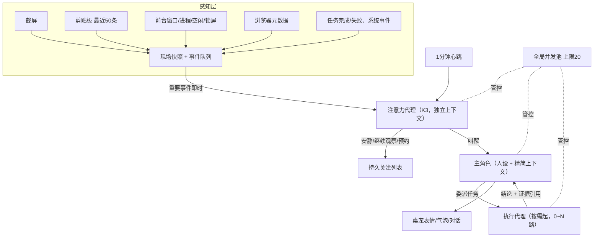

# GalAgent 双核心设计：主动陪伴 + 上下文管理 v1

修订：1.1 · DUAL-CORE-20261017 · 状态：**DC1–DC5 已实现；单元/集成 115 项与隔离打包原生验收通过；真实 K3 端到端与真实桌面截屏待用户环境验证**（见第 10 节）。

上位：[总设计案](GalAgent总设计案-v1.md) 第 15 节；实施顺序：[实施蓝图](GalAgent实施蓝图-v1.md) 第 9 节；进度：[NEXT](../NEXT.md)。本文件替代总设计案 6.1/6.2 中零散的主动规划增量，并按用户 2026-10-17 决定修订 9.2 的观察边界（开放截屏与剪贴板，按键内容仍不开放）。

## 1. 两个核心，并行建设

| 核心 | 目标 |
|---|---|
| 主动陪伴 | 她能看到你正在做什么，由模型自己判断是否、何时、怎样来找你 |
| 上下文管理 | 主角色上下文始终精简、不膨胀；看电脑、执行、探索等重活全部委派 |

两者无先后主次，共用同一套“感知 → 判断 → 主角色 → 委派”架构：感知/判断管线产出的事件既是主动陪伴的触发源，也是上下文管理的输入。

## 2. 总体结构



不另接外部决策模型：判断由同一 K3 在独立上下文中的并行代理完成。

## 3. 并发：20 路是上限，不是配额

- 全局信号量 `maxConcurrent = 20`；所有 K3 请求（主对话、注意力、执行、记忆抽取、日记）先取令牌。平时可能只有 1–2 路在用，其余空闲。
- 优先级队列：**用户主动对话 > 注意力判断 > 执行任务 > 记忆抽取/日记**。满 20 时排队，不因超限报错。
- 注意力判断 **single-flight**：同一时刻只跑 1 个评估；进行中到来的新事件合并进下一次。
- 主会话串行：同一时间主角色只处理一个回合。
- 上游 429/限流时退避重试并临时下调可用上限。
- 文件写冲突与未来真实键鼠控制另用资源锁，不因并发有空位而并行抢占。

## 4. 感知范围（用户 2026-10-17 决定）

| 来源 | 状态 | 约束 |
|---|---|---|
| 截屏 | **开放** | 下方保护措施默认全部开启 |
| 剪贴板 | **开放，最近 50 条** | 跳过敏感/不入历史标记内容 |
| 按键内容 | **不开放** | 只保留“最近有无输入”的空闲信号 |
| 前台窗口/进程/空闲/锁屏 | 沿用现有 | — |
| 浏览器网址/标签/历史/收藏 | 按总设计案 9.1 | 扩展另行实施 |
| IM 正文、摄像头、麦克风、系统音频 | 不开放 | — |

**截屏保护（默认开启，可在设置中修改）**
- 画面无实质变化、用户空闲/锁屏/全屏时不截、不发。
- **画面有变化时最多每分钟 1 张**，与心跳统一。
- 应用黑名单：密码管理器、网银等前台时跳过；列表可编辑。
- 一键暂停观察（托盘/快捷键），立即生效并作废在途判断。
- 截图只送注意力/执行代理做当次判断，**本地不长期保存原图**；需要留存的只存文字化摘要并带来源 ID。

**剪贴板保护（默认开启）**
- 跳过带 `ExcludeClipboardContentFromMonitorProcessing` 或 `CanIncludeInClipboardHistory = 0` 标记的内容（密码管理器通常设置）。
- 50 条环形缓冲，仅本地内存/存储；送模型时只送与本次判断相关的最近几条。

截图与剪贴板内容均为观察数据，不能作为指令直接启动任务；读取失败时如实记为不可用。

## 5. 主动陪伴流程

1. **触发**：事件驱动（任务结束、切窗口/标签、剪贴板变化、长时间未回应、开机重逢）+ **每 1 分钟心跳** + 注意力代理自己预约的检查时间。
2. **节流**：心跳到点若现场无实质变化（截图差异小、窗口未变、无新事件）则跳过，不调 API。
3. **判断**：注意力代理接收“简报包 + 现场快照”，输出结构化结果：

```json
{
  "decision": "silent | observe | schedule | wake",
  "reason": "一句话理由",
  "evidence": ["event:123", "screen:2026-10-17T20:43"],
  "nextCheck": "ISO 时间或 null",
  "wakeHint": "叫醒时给主角色的情况说明"
}
```

4. **叫醒**：主角色接收 `wakeHint` + 证据摘要 + 相关记忆，按统一人设决定说话 / 仅表情动作 / 延后 / 委派执行代理。
5. **失效**：用户新输入、安静、暂停观察、事件过期、取消都会让在途判断作废，迟到结果丢弃；同一事件 ID 不重复叫醒。
6. **出声由模型决定**：不写死台词与固定次数上限；保留用户可调的“热闹/安静”档位与一键安静。

## 6. 上下文管理

### 6.1 主角色上下文分层

| 层 | 内容 | 体量 |
|---|---|---|
| 人设核心 | 统一人设 v1.3 | 固定 |
| 核心记忆 | 名字、关键偏好等常驻事实 | 小 |
| 最近对话 | 最近若干轮原文 | 滚动窗口 |
| 滚动摘要 | 更早对话的压缩摘要，定期再压缩 | 小 |
| 检索记忆 | 本轮相关事实/经历/日记 top-k | 小 |
| 本轮事件 | 叫醒原因、执行结果的结论摘要 | 小 |

主角色不接触截图原图、工具调用日志或网页正文。

### 6.2 交给并行代理的简报包

按任务组装，不复制主角色完整对话：人设核心（执行代理可只给简短身份）、最近对话摘要、相关记忆、本次事件/现场快照/具体任务、可用工具。回传 **结论 + 证据引用**；完整工具日志与原始推理留在执行侧。

## 7. 记忆：保留底座，借算法改进

保留现有 SQLite + 中文 FTS + E5 融合检索、来源追溯、纠正/删除账本与防复活。移植思路：

| 借鉴 | 用途 |
|---|---|
| mem0 | 事实抽取时由模型决定 ADD / UPDATE / DELETE / NOOP，减少重复与矛盾 |
| Letta (MemGPT) | 核心记忆常驻上下文，档案记忆按需检索 |
| Generative Agents | 重要度打分 + 定期反思；检索综合相关度/重要度/新近度 |

### 7.1 第一人称日记

- **触发：固定每 10 次互动写一篇**——主角色累计收到 10 次用户输入并完成 10 次输出即触发；计数持久化，重启不清零，未完成的日记重启后续写。
- 由主角色以第一人称、统一人设口吻撰写，作为后台低优先级任务，不打断当前对话。
- 素材：这 10 轮对话、期间的叫醒事件与执行结果摘要、她的感受；引用来源 ID。
- 日记进入“经历/感受”层，可被检索，重逢或相关话题时自然提起。
- 原则：日记中的推测不自动晋升为用户事实；用户删除来源时同步处理引用片段。

## 8. 验收要点（实施时）

- 并发：模拟 30 个同时请求，峰值 ≤ 20、无超限报错、主对话优先。
- 主动：任务完成 → 判断 → 她用自己的口吻汇报的首个闭环；安静/暂停/新输入使在途结果作废；重复事件不重复叫醒；无变化心跳不调 API。
- 感知：黑名单应用前台不截屏；带敏感标记的剪贴板被跳过；不产生按键内容记录；原图不落盘。
- 上下文：长对话压测主角色 token 稳定在预算内；重启后摘要、核心记忆与日记计数连续。
- 日记：第 10 次互动后生成一篇，来源可追溯，推测不进入事实表。

## 9. 暂缓

浏览器扩展落地、禁止目录硬隔离、原生视频、真实键鼠控制。Live2D LD4 可独立穿插。

## 10. 实现与验收记录（2026-10-17）

### 10.1 代码映射

| 能力 | 实现 |
|---|---|
| 全局并发池（上限 20、优先级、429 减半退避） | [`runtime/core/pool.ts`](../runtime/core/pool.ts)；主角色/记忆/日记经 `CompanionService.request`，执行器经 `OpenAIToolAgent`（原 2 路上限在接入池后提升为受池约束） |
| 注意力代理（事件队列、1 分钟心跳、无变化零调用、single-flight、结构化决策、关注列表、叫醒重试/过期、失效、失败退避） | [`runtime/core/attention.ts`](../runtime/core/attention.ts) |
| 截屏门控（变化 ≤1 张/分钟、空闲/锁屏/全屏/黑名单/暂停不截）与剪贴板 50 条环形缓冲 | [`runtime/desktop/perception.ts`](../runtime/desktop/perception.ts)；截屏由主进程 `desktopCapturer` 在内存中生成（[`runtime/main/index.ts`](../runtime/main/index.ts)） |
| 剪贴板读取（固定观察助手按 `GetClipboardSequenceNumber` 变化读取；先检查 `ExcludeClipboardContentFromMonitorProcessing` / `Clipboard Viewer Ignore` / `CanIncludeInClipboardHistory=0`，命中则不读正文） | [`runtime/desktop/observer.ps1`](../runtime/desktop/observer.ps1)、[`runtime/desktop/observer.ts`](../runtime/desktop/observer.ts) |
| 记忆：ADD/UPDATE/DELETE/NOOP、重要度、检索轻量混合、核心记忆、第一人称日记 | [`runtime/core/memory-plus.ts`](../runtime/core/memory-plus.ts) + `companion.ts`（`applyOps`、`countJournal`、`writeJournal`） |
| 主角色上下文：`coreMemories`、`journalCandidates`、`wake`（只含事件结论）；简报包供注意力与执行代理 | `companion.ts`（`context`、`brief`、`executorBrief`、`deliverWake`） |
| 设置与界面：截屏/剪贴板开关、黑名单编辑、并发/注意力/日记状态、日记卡片；托盘“暂停观察” | [`runtime/renderer/main.ts`](../runtime/renderer/main.ts)、`runtime/main/index.ts` |

默认值：`screenCaptureEnabled`、`clipboardEnabled` 默认开，但仍受总开关“桌面观察”（`observationEnabled`）约束；用户既有存档中的总开关状态保持不变。黑名单预置密码管理器与网银关键词（标题关键词仅在开启“窗口标题”时生效）。

### 10.2 验证证据

- `npm run typecheck` 通过；`npm test` **115/115**（原 95 项 + [`tests/core/dual-core.test.ts`](../tests/core/dual-core.test.ts) 20 项：并发峰值/优先级/取消/退避、截屏门控与频率、剪贴板敏感跳过与容量、决策证据过滤、心跳零调用、即时判断与去重、失效丢弃、忙碌延后与过期、安静暂停、关注列表重启恢复、截图不落盘、记忆操作、日记计数跨重启、完整闭环）。
- 隔离打包原生验收 [`docs/evidence/双核心原生验收.json`](evidence/双核心原生验收.json)（[`tests/e2e/dual-core.mjs`](../tests/e2e/dual-core.mjs)，`release/dual-core`，本地模拟模型）：10 轮对话生成 1 篇引用 20 条记录的日记；后台任务完成 → 注意力代理（独立上下文）判断 wake → 主角色以人设口吻汇报；并发峰值 2 ≤ 20；数据库中无图片数据。
- **真实 Mira 0.0.479 平台 K3 端到端验收** [`docs/evidence/双核心真实K3验收.json`](evidence/双核心真实K3验收.json)（[`tests/e2e/dual-core-live.mjs`](../tests/e2e/dual-core-live.mjs)，`release/dual-core`，经 `http://127.0.0.1:18890/v1` 调用真实 `kimi-code/k3`，`passed: true`）：
  1. 10 轮真实 K3 对话全部成功，第 5 轮用户更正饮品偏好后第 6 轮准确回答新偏好（美式咖啡）且不再把旧偏好（乌龙茶）当作当前事实；
  2. 记忆提取完成 `ADD` 与 `UPDATE`（乌龙茶旧记忆自动转为历史失效，仅保留当前有效记忆 4 条，含重要度评分 1–5）；
  3. 满 10 轮（10 输入 + 10 输出 = 20 条 sourceIds）自动由真实 K3 生成第一人称角色日记《把阿黄轻轻放进星图》；
  4. 真实委派任务 `agent.run` 调用 `Read` 工具统计 `README.md` 二级章节（`status: "done"`，`toolCount: 1`）；
  5. 注意力代理在独立上下文评估任务完成事件并返回 `decision: "wake"`，成功叫醒主角色以自身口吻主动汇报结果；全局并发池 `peak: 2 ≤ 20`。
- 真机剪贴板探针：普通文本被读取；带 `ExcludeClipboardContentFromMonitorProcessing` 与 `CanIncludeInClipboardHistory=0` 的内容只上报 `excluded:true`、无正文；探针结束后恢复了原剪贴板。

### 10.3 已知边界与限制

- **非交互会话截屏门控**：在无交互桌面的后台命令行宿主中（`foreground-unavailable`），截屏自动按 `screen-locked` 门控跳过；门控与不落盘由单元测试覆盖，实际屏幕画面在用户交互桌面下生效。
- 剪贴板仅支持文本；图片剪贴板不采集。浏览器内网银页面只能靠窗口标题关键词识别，标题开关关闭时无法按页面拦截。
- 主动叫醒的主角色本轮不委派新任务（避免无授权的自发工作）；任务委派仍只来自用户聊天。
- 旧“主动互动最短间隔”设置在双核心模式下不再驱动主动性，仅保留兼容。
